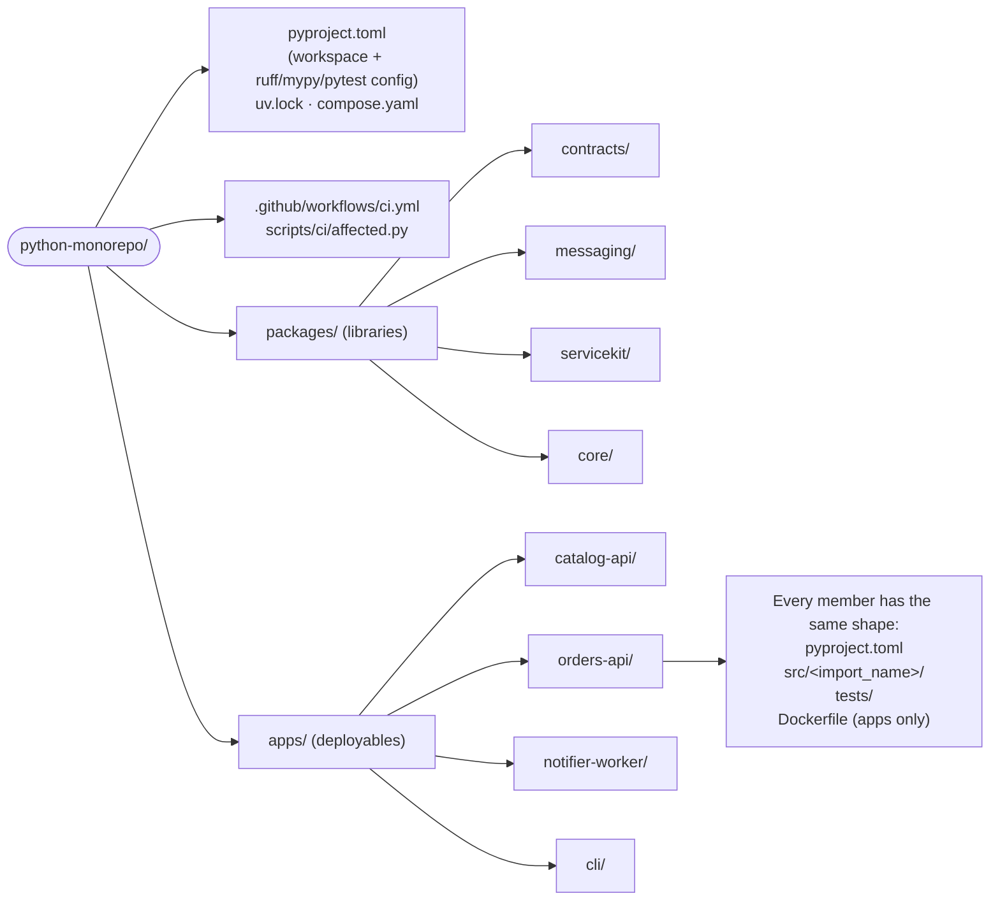
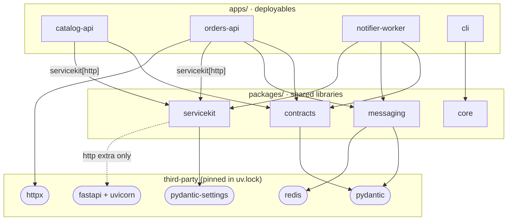
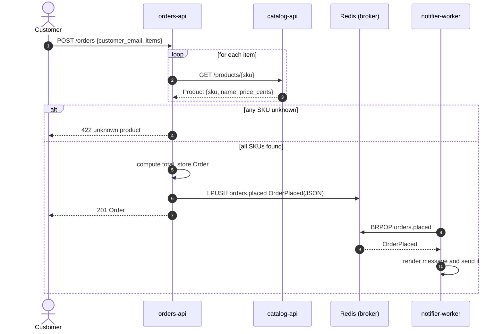
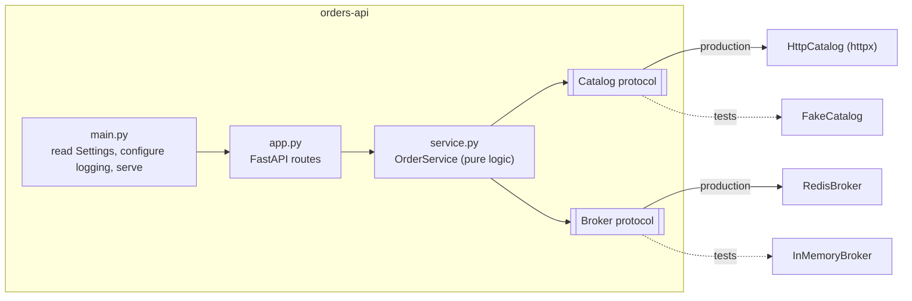
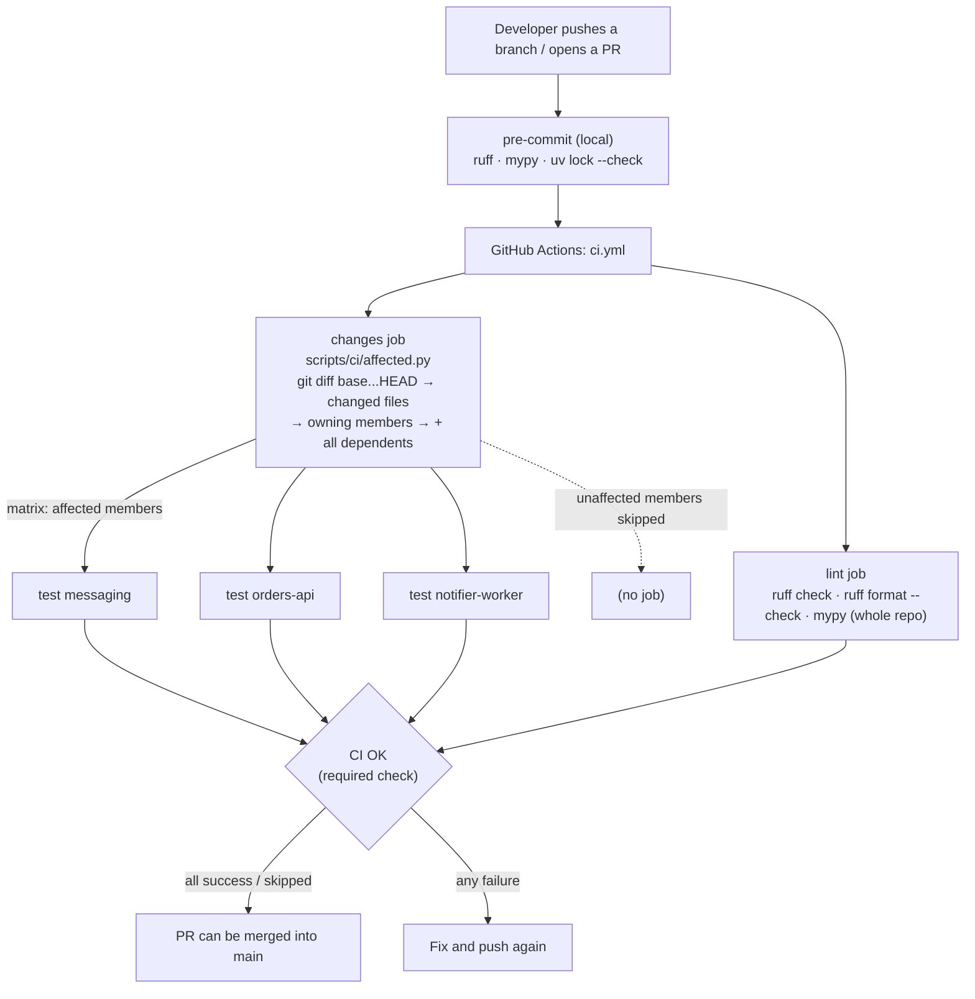
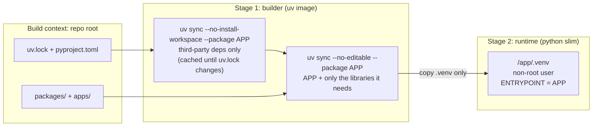
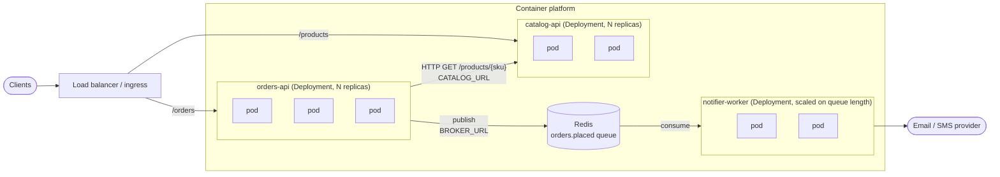

# Architecture

This repository is a **Python monorepo**: many independently deployable services and the
libraries they share live in one Git repository, managed as a single
[uv workspace](https://docs.astral.sh/uv/concepts/projects/workspaces/) with one lockfile.

The example system is a tiny shop:

| Member | Kind | What it does |
| --- | --- | --- |
| `apps/catalog-api` | HTTP service | Owns the product list and prices. |
| `apps/orders-api` | HTTP service | Accepts orders, prices them by calling `catalog-api`, publishes an `OrderPlaced` event. |
| `apps/notifier-worker` | Background worker | Consumes `OrderPlaced` events and sends a confirmation to the customer. |
| `apps/cli` | Command-line app | The original "hello" example. |
| `packages/contracts` | Library | Shared pydantic models: API payloads (`Product`, `Order`, ...) and events (`OrderPlaced`). |
| `packages/messaging` | Library | `Broker` interface with Redis (production) and in-memory (tests) implementations, plus typed `publish_event` / `receive_event`. |
| `packages/servicekit` | Library | Settings from env vars, uniform logging, and (with the `http` extra) a FastAPI app factory with `/health`. |
| `packages/core` | Library | The original greeting helper used by `apps/cli`. |

## Principles

1. **`packages/` are libraries, `apps/` are deployables.** Libraries are imported; apps are
   run. An app never imports another app.
2. **Services talk over the network, not through imports.** `orders-api` calls `catalog-api`
   over HTTP and reaches `notifier-worker` through the message broker. What they share is the
   *shape* of the data, in `packages/contracts`.
3. **One lockfile, one version of each dependency.** Every member resolves against the same
   `uv.lock`, so there is no "works with my version" drift between services.
4. **Each app ships alone.** Every app has its own `Dockerfile` that installs only that app and
   the libraries it depends on, so each one is built, released and scaled on its own.
5. **CI tests what a change can break.** A change to a library re-tests the library and every
   app that depends on it; untouched members are skipped.

## Repository layout



## Dependency graph

Arrows point from a member to what it depends on. This is the graph CI walks (in reverse) to
decide what to test.



`notifier-worker` depends on plain `servicekit` (without the `http` extra), so FastAPI and
uvicorn never end up in its image.

| If you change... | CI tests... |
| --- | --- |
| `packages/contracts` | contracts, catalog-api, orders-api, notifier-worker |
| `packages/messaging` | messaging, orders-api, notifier-worker |
| `packages/servicekit` | servicekit, catalog-api, orders-api, notifier-worker |
| `packages/core` | core, cli |
| `apps/orders-api` | orders-api only |
| root `pyproject.toml`, `uv.lock`, CI files, `compose.yaml` | everything |
| `*.md`, `docs/` | nothing (lint still runs) |

## Runtime: how the services interact



The broker is a work queue: each event goes to exactly one worker replica, so running more
`notifier-worker` replicas spreads the load rather than sending duplicate notifications.

### Inside a service

Each app keeps business logic apart from transport so it can be tested without a network:



## Build and CI flow



The matrix shown is what a change to `packages/messaging` produces: messaging plus its two
dependents, while catalog-api, cli and the other libraries are skipped. To see what CI would
test for your branch, run `python3 scripts/ci/affected.py --base origin/main`.

## Container build

Every app's `Dockerfile` follows the same two-stage pattern and is built **from the repo root**
so it can see `uv.lock` and the shared libraries:



What actually lands in each image:

| Image | Workspace libraries | Notable third-party |
| --- | --- | --- |
| `catalog-api` | contracts, servicekit | fastapi, uvicorn |
| `orders-api` | contracts, messaging, servicekit | fastapi, uvicorn, httpx, redis |
| `notifier-worker` | contracts, messaging, servicekit | redis (no web server) |
| `cli` | core | none |

```bash
docker build -f apps/orders-api/Dockerfile -t orders-api .
```

## Deployment

Each image is deployed and scaled on its own. The same topology runs locally with
`docker compose up --build` (see `compose.yaml`) and maps directly onto Kubernetes,
ECS, Cloud Run, etc.



Health checks: HTTP services expose `GET /health` (from `servicekit.http.create_app`) and their
images declare a Docker `HEALTHCHECK`, which `compose.yaml` uses to start `orders-api` only once
`catalog-api` is healthy. The worker shuts down cleanly on `SIGTERM`.

Configuration is by environment variable only (`servicekit.ServiceSettings`):

| Variable | Used by | Default |
| --- | --- | --- |
| `PORT`, `HOST` | HTTP services | `8000`, `0.0.0.0` |
| `LOG_LEVEL` | all | `INFO` |
| `ENVIRONMENT` | all (shown in `/health`) | `local` |
| `CATALOG_URL` | orders-api | `http://localhost:8001` |
| `BROKER_URL` | orders-api, notifier-worker | `memory://` (orders-api), `redis://localhost:6379/0` (worker) |

The example services keep their data in memory to stay dependency-free; a real
service would put a database behind the same repository class.

## Adding a new service

With Claude Code, ask it to create the service: the `new-service` skill
(`.claude/skills/new-service/`) does every step below and verifies the result. You can also run
its scaffold script yourself:

```bash
python3 .claude/skills/new-service/scripts/scaffold.py inventory-api --kind http --broker
python3 .claude/skills/new-service/scripts/scaffold.py audit-worker --kind worker \
    --event OrderPlaced --topic ORDER_PLACED_TOPIC
```

To do it by hand:

1. Copy the closest example (`apps/catalog-api` for HTTP, `apps/notifier-worker` for a worker)
   to `apps/<name>/` and rename the package, the `[project.scripts]` entry and the
   `src/<import_name>/` directory.
2. In its `Dockerfile`, change `ARG APP=` and `ENTRYPOINT` to the new name.
3. Add `apps/<name>/src` to `mypy_path` and the import name to ruff's `known-first-party` in the
   root `pyproject.toml`.
4. If it exchanges data with other services, put the models in `packages/contracts`.
5. Run `uv sync --all-packages`, commit the updated `uv.lock`, and add it to `compose.yaml`.

CI picks the new member up automatically.
