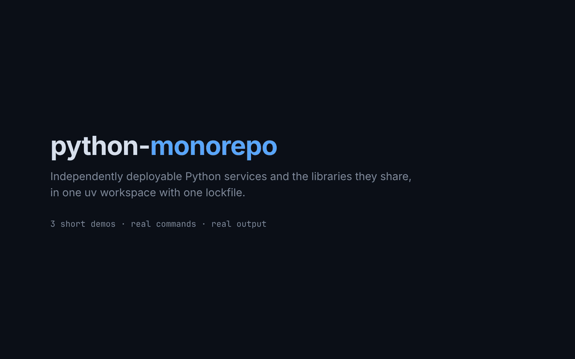

# python-monorepo

A Python monorepo managed as a [uv workspace](https://docs.astral.sh/uv/concepts/projects/workspaces/).
All members share one virtualenv and one `uv.lock`.



<sub>Real commands and output, replayed by [`docs/demo/player.html`](docs/demo/player.html). Also available as an [MP4](docs/demo.mp4).
A second video, [`docs/brokers.gif`](docs/brokers.gif) ([MP4](docs/brokers.mp4)), walks through the pluggable transport:
Redis, the TCP broker, scaling workers and the contract tests. Regenerate both with `node docs/demo/record.mjs`.</sub>

See **[ARCHITECTURE.md](ARCHITECTURE.md)** for diagrams of the layout, dependency graph,
runtime flow, CI and deployment.

## Layout

```
.
├── pyproject.toml          # workspace root (virtual, not published) + ruff/mypy/pytest config
├── uv.lock                 # single lockfile for the whole workspace
├── compose.yaml            # run all services together locally (one profile per broker)
├── .env, brokers/*.env     # which broker compose starts and BROKER_URL points at
├── .claude/skills/         # new-service: scaffold a fully wired service (Claude Code skill)
├── docs/                   # demo videos (+ the player/recorder that renders them)
├── packages/               # reusable libraries
│   ├── contracts/          # shared pydantic models: API payloads + events
│   ├── messaging/          # Broker interface + Redis / RabbitMQ / TCP / in-memory backends
│   ├── servicekit/         # settings, logging, FastAPI app factory with /health
│   └── core/               # tiny greeting helper used by apps/cli
└── apps/                   # deployables, each with its own Dockerfile
    ├── catalog-api/        # HTTP: product catalog
    ├── orders-api/         # HTTP: places orders, calls catalog-api, publishes events
    ├── notifier-worker/    # worker: consumes order events, sends notifications
    ├── tcp-broker/         # optional dependency-free broker server for tcp:// URLs
    └── cli/                # command-line example
```

Every member has the same shape: `pyproject.toml`, `src/<import_name>/`, `tests/`.

## Getting started

```bash
uv sync --all-packages        # create .venv with every member + dev tools
uv run pre-commit install     # enable git hooks
uv run cli Ada                # -> Hello, Ada!
```

Run the example services together (needs Docker):

```bash
docker compose up --build
curl localhost:8001/products
curl -X POST localhost:8002/orders -H 'content-type: application/json' \
     -d '{"customer_email":"ada@example.com","items":[{"sku":"MUG-001","quantity":2}]}'
docker compose logs notifier-worker   # -> "notify to=ada@example.com ..."
```

The services don't care which message broker carries their events; `BROKER_URL` decides.
Redis is the default. To run the same stack on another broker, pick its env file:

```bash
docker compose --env-file brokers/rabbitmq.env up --build   # RabbitMQ
docker compose --env-file brokers/tcp.env up --build        # built-in TCP broker
docker compose --profile "*" down                           # stop, whichever is running
```

Without Docker, run the services with `uv run` and point them at any broker you have, for
example the built-in TCP broker:

```bash
uv run tcp-broker &
export BROKER_URL=tcp://localhost:7000          # or redis://localhost:6379/0
PORT=8001 uv run catalog-api &  PORT=8002 uv run orders-api &  uv run notifier-worker &
```

See [ARCHITECTURE.md](ARCHITECTURE.md#messaging-a-pluggable-transport) for how the transport
is plugged in and how to add another one.

## Everyday commands

```bash
uv run ruff check .           # lint
uv run ruff format .          # format
uv run mypy                   # type-check (strict)
uv run pytest                 # run all tests
uv run pytest packages/core   # test one member
uv run pre-commit run --all-files
```

## Adding a member

1. Create `packages/<name>/` (library) or `apps/<name>/` (deployable) with a
   `pyproject.toml` and `src/<name>/` layout. `uv init --lib packages/<name>` works too.
2. Depend on another member by listing it in `dependencies` **and** marking it as a
   workspace source:

   ```toml
   [project]
   dependencies = ["core"]

   [tool.uv.sources]
   core = { workspace = true }
   ```

3. Add its `src` dir to `mypy_path` and its import name to ruff's `known-first-party`
   in the root `pyproject.toml`.
4. Run `uv sync --all-packages` and commit the updated `uv.lock`.

Third-party dependencies go in the member that uses them (`uv add --package <name> <dep>`);
shared dev tooling lives in the root `dev` dependency group.

## Deploying services independently

Each app under `apps/` is its own deployable with its own `Dockerfile`, built from the
repo root so the shared lockfile is used but **only that app and the workspace packages it
depends on** are installed (no dev tools, no other apps):

```bash
docker build -f apps/orders-api/Dockerfile -t orders-api .
docker build -f apps/cli/Dockerfile -t cli .
docker run --rm cli Ada
```

Because every app gets its own image, each one can be versioned, released and scaled
(replicas, autoscaling, resources) on its own. A change to `packages/core` only needs to
rebuild the apps that depend on it. To add a service, copy the closest example app (see
[ARCHITECTURE.md](ARCHITECTURE.md#adding-a-new-service)).

## CI

`.github/workflows/ci.yml` runs on every pull request and on pushes to `main`:

- **Lint and type check**: `ruff check`, `ruff format --check` and `mypy` over the whole repo.
- **Tests**: `pytest` runs only for the members that changed **plus every member that
  depends on them**, one matrix job per member. `scripts/ci/affected.py` works this out
  from the workspace `pyproject.toml` files, so there is nothing extra to maintain when you
  add a member. A change to a shared file outside any member (root `pyproject.toml`,
  `uv.lock`, the workflow itself, ...) runs every member; Markdown and `docs/` changes run none.
- **Brokers / end-to-end**: when `packages/messaging` or a service using it changes, the
  messaging tests also run against real Redis and RabbitMQ, and the compose stack is started
  once per broker (`scripts/ci/compose_smoke.sh`) to send a real order through it.
- **CI OK**: a single summary job to mark as required in branch protection; it passes when
  test jobs are skipped because nothing relevant changed.

uv's cache is keyed on `uv.lock`, and `UV_LOCKED=1` fails the build if the lockfile is out
of date. To see what CI would test for your branch:

```bash
python3 scripts/ci/affected.py --base origin/main
```
